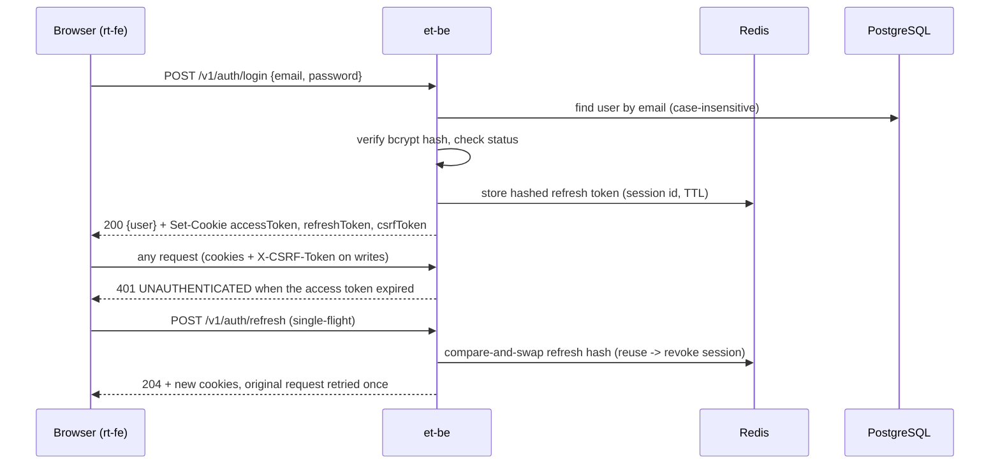

# Authentication

## Overview

Baseline feature of every project built from this template. Users sign in with email and password;
the session lives in httpOnly cookies, never in JavaScript-readable storage. Short-lived access tokens
are renewed with rotating refresh tokens; reusing an already-rotated refresh token revokes the session.
Decision record: workspace `contracts/decisions/0002-cookie-auth-csrf.md`.

## Contract

- OpenAPI: workspace `contracts/openapi/auth.yaml` - operations `login`, `refreshSession`, `logout`, `whoami`.
- Error codes: `INVALID_CREDENTIALS` (401, same for unknown email and wrong password), `FORBIDDEN` (403, disabled
  account), `UNAUTHENTICATED` (401), `CSRF_INVALID` (403), `VALIDATION_FAILED` (422), `RATE_LIMITED` (429).

## How it works

- Login is rate limited per IP (`rl:login:`, 10 per 15 minutes) and exempt from CSRF.
- CSRF is enforced globally on POST/PUT/PATCH/DELETE (double submit).

## Code map

| Layer | Files |
|---|---|
| Domain | `src/domain/entities/User.ts`, `src/domain/interfaces/{IUserRepository,IPasswordHasher,ITokenService,IRefreshTokenStore}.ts` |
| Use cases | `src/use-cases/auth/{Login,RefreshSession,Logout,GetCurrentUser}UseCase.ts` |
| Infrastructure | `src/infrastructure/repositories/PgUserRepository.ts`, `src/infrastructure/security/*` |
| Interface | `src/interface/controllers/AuthController.ts`, `src/interface/routes/authRoutes.ts`, `src/interface/validation/authSchemas.ts`, `src/interface/presenters/UserPresenter.ts`, `src/interface/middlewares/{auth,csrf,rateLimiter}Middleware.ts` |
| Composition | `src/modules/authModule.ts` |

## Data

- Table `users` (Prisma model `User`, commented starter in `prisma/schema.prisma`): unique email, `role_name`,
  `status`. Refresh sessions live in Redis only (`auth:refresh:<sessionId>`, `auth:user-sessions:<userId>`).

## Configuration

`JWT_ACCESS_SECRET`, `JWT_REFRESH_SECRET`, `JWT_ACCESS_TTL` (15m), `JWT_REFRESH_TTL` (7d), `COOKIE_SECURE`,
`COOKIE_DOMAIN`, `CORS_ORIGINS` - see `docs/configuration.md`.

## Testing

Planned: unit tests per use case (`tests/unit`), `PgUserRepository` integration test, `auth.routes` e2e test
(cookies, CSRF, refresh rotation, reuse detection). See `tests/README.md`.

## Operational notes

- Revoke all sessions of a user: `IRefreshTokenStore.revokeAllForUser` (e.g. after a password change).
- Watch `401` spikes on `/v1/auth/refresh` (possible token reuse attempts) in logs by request id.
