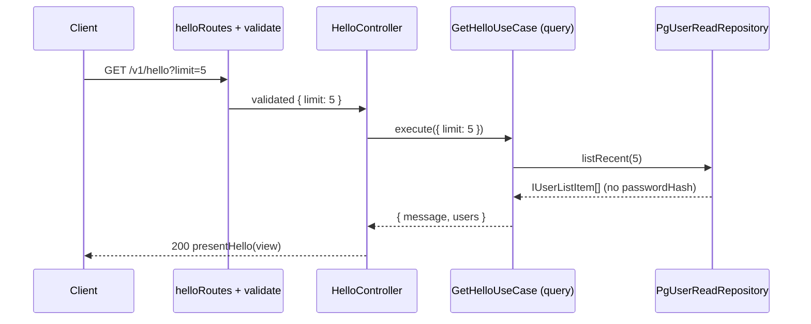

# Hello (boilerplate demo)

## Overview

The template's working example. `GET /v1/hello` answers `{ "message": "hello", "users": [...] }` with the
newest users from the `users` table, which `npm run db:seed` fills with three demo rows through the
`CreateUserUseCase` command. It exists to show, in running code, how every folder of `src/` cooperates
(`docs/architecture.md`). Mounted only when `DEMO_ROUTES` is true (default: everywhere except production).

## Contract

- Exported spec: `docs/openapi.json` -> `showHello` (fragment `src/docs/helloDocs.ts`). Demo only: it has
  no workspace contract in `contracts/openapi/`.
- Query `limit`: integer 1-50, default 10. Error codes: `VALIDATION_FAILED` (422, `details.fields.limit`),
  `INTERNAL_ERROR` (500, database down).

## How it works

Write side (seed): `scripts/seedDemoUsers.ts` -> `CreateUserUseCase` -> `User.create()` (invariants) ->
`PgUserRepository.save()` (unique email -> `CONFLICT`, skipped by the seed).

## Code map

| Layer | Files |
|---|---|
| Domain | `src/domain/entities/User.ts`, `src/domain/interfaces/{IUserRepository,IUserReadRepository}.ts`, `src/domain/constants/roles.ts` |
| Use cases | `src/use-cases/hello/queries/GetHelloUseCase.ts`, `src/use-cases/users/commands/CreateUserUseCase.ts` |
| Infrastructure | `src/infrastructure/repositories/{PgUserRepository,PgUserReadRepository}.ts`, `src/infrastructure/database/prismaClient.ts` |
| Interface | `src/interface/{routes/helloRoutes,controllers/HelloController,validation/helloSchemas,presenters/HelloPresenter,presenters/UserPresenter}.ts` |
| Composition | `src/modules/helloModule.ts`, `scripts/seedDemoUsers.ts` |

## Data

Table `users` (migration `init`): uuid id, unique lowercase email, password hash, names, Postgres enums
`user_role` / `user_status`, timestamps; index on `created_at DESC` for the newest-first list.

## Configuration

`DEMO_ROUTES` (default on except production), `SEED_DEMO_DATA` (seed at boot), `DATABASE_URL`. A fresh
container with both flags true creates the tables and serves the demo data on first start.

## Testing

Unit: `tests/unit/{User,CreateUserUseCase,GetHelloUseCase}.test.ts`. e2e (no DB):
`tests/e2e/{hello,health}.routes.test.ts`. Integration (real Postgres): `tests/integration/PgUserRepositories.test.ts`.

## Operational notes

Remove the demo once real features exist (`docs/architecture.md` section 6), or keep `DEMO_ROUTES=false`.
It lists user emails without authentication - never enable it on a public production deployment.
